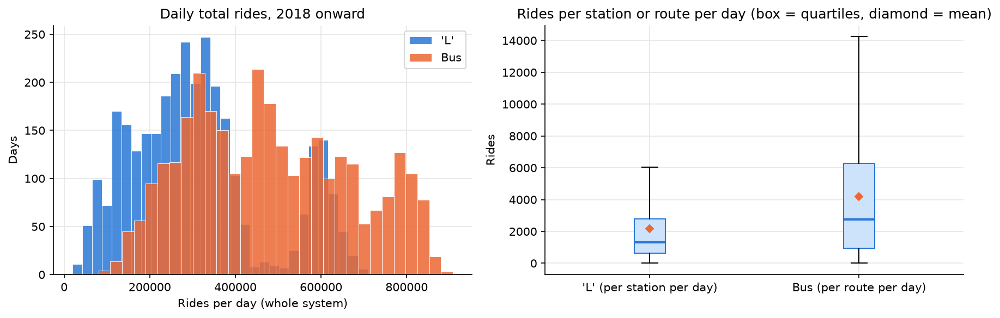
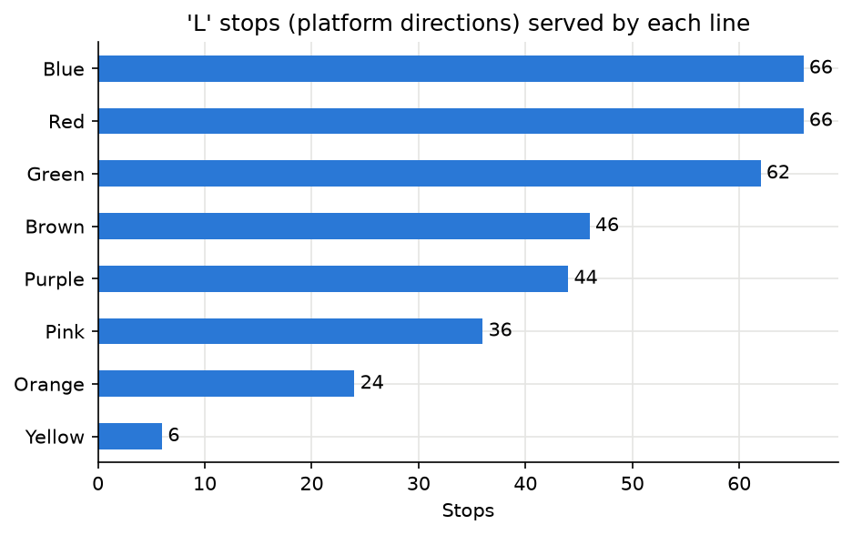

# Exploratory Data Analysis and Data Cleaning – Ride or Rail?

CS 483 Big Data Mining · Team Loop Miners (Harsh Shah, Dharmik Patel, Yousuf Hussain)

This report covers Piazza Requirement 3: EDA and data cleaning for every data source, run in parallel with Apache Spark on Google Cloud Dataproc Serverless. Each section lists the checks, the statistics and plots, the outliers we found and how we handled them, and the Spark DAGs from the cloud runs.

| Data source | Owner | Code |
| --- | --- | --- |
| Rideshare trips (3 tables, 628M rows) | Harsh Shah, Dharmik Patel | `notebooks/01_data_quality_full.ipynb`, `notebooks/03_trip_eda.ipynb` |
| Supporting datasets (CTA, boundaries, socioeconomic, ACS, weather) | Yousuf Hussain | `src/eda/supporting_eda.py`, `notebooks/09_supporting_eda_spark.ipynb` |

## Rideshare trips

To be added by Harsh and Dharmik.

## Supporting datasets

### Method

`src/eda/supporting_eda.py` runs every check in Spark on all 7 supporting sources (8 files, 108 MB). It ran on Dataproc Serverless (runtime 2.2, Spark 3.5) as batch `shuss26-supporting-eda-1120` on Nov 20, 2026, in about 6 minutes. The CTA files are split into 16 MB input partitions, so each check runs as parallel tasks. For each source the job:

- reads the file as text, so it can count values that fail to parse as numbers or dates;
- checks missing values in every column, exact duplicate rows, duplicate keys, formatting and type problems, and value ranges;
- computes count, mean, standard deviation, min, quartiles, max and skewness for the selected features, and value counts for categorical ones;
- tests every numeric feature for outliers with both the IQR rule (outside Q1 − 1.5·IQR to Q3 + 1.5·IQR) and z-scores (|z| > 3);
- writes the cleaned data as Parquet to `gs://ride-or-rail-data-ride-or-rail-123456/results/eda_supporting/clean/`.

The summary tables are in `results/eda_supporting/`, and `notebooks/09_supporting_eda_spark.ipynb` plots them.

| Source | Rows | Features explored |
| --- | --- | --- |
| CTA 'L' daily entries (`5neh-572f`) | 1,333,391 | rides per station-day, daily system total, day type, year |
| CTA bus daily totals (`jyb9-n7fm`) | 1,120,604 | rides per route-day, daily system total, day type, routes |
| CTA 'L' stops (`8pix-ypme`) | 302 | latitude, longitude, lines served, ADA access |
| Community areas (`igwz-8jzy`) | 77 | area (km²), perimeter (km), geometry |
| Socioeconomic indicators 2008–2012 (`kn9c-c2s2`) | 78 | per capita income, poverty, unemployment, education, crowding, dependency, hardship |
| ACS 5-year by community area (`t68z-cikk`) | 77 | total population, households, share of households under $25k and $125k+ |
| NOAA daily weather, O'Hare and Midway | 39,991 | daily high and low, precipitation, snowfall, snow depth, wind (2018 onward) |

### Findings

**CTA ridership.** Since 2018 the 'L' carries a median of 290,012 rides a day and the bus system 465,000. Both distributions have two humps, before and after COVID. Rides per station are right-skewed (skewness 2.9): half of the 'L' station-days have fewer than 1,320 rides, while Lake/State averages about 10,000. Ride counts are written with thousands commas in 72% of 'L' rows and 79% of bus rows.

**'L' stops.** 302 platform-direction stops for 144 stations; all locations parse and lie in the Chicago region. Red and Blue have the most stops (66 each), Yellow the fewest (6), and 74% of stops are ADA accessible.

**Community areas.** All 77 areas, numbered 1–77 with no gaps. The median area is 7.4 km²; O'Hare (34.5 km²), South Deering (28.2 km²) and Austin (18.5 km²) are much larger.

**Socioeconomic indicators.** After removing the city-wide row there are no missing values, and all percentages are in range. Per capita income is the most skewed feature (skewness 1.9): the median area has $21,323 and the Near North Side $88,669. Poverty goes from 3.3% to 56.5% of households.

**ACS.** 77 areas, all from ACS 2023, with a median of 29,052 residents (largest: Austin, 100,278). The share of households earning under $25,000 goes from 2% to 52%.

**Weather.** Both stations have every day since 2018 (3,217 days each) and no day with the low above the high. Midway does not record snowfall, so snow comes from O'Hare. The extremes are real: −30.5 °C during the January 2019 polar vortex and 89.7 mm of rain on May 14, 2020.

### Outliers

| Feature | IQR rule | z-score rule | Decision |
| --- | --- | --- | --- |
| 'L' rides per station-day | 7.2% high | 2.1% high | Keep: busiest downtown stations; use log scale |
| Bus rides per route-day | 3.5% high | 1.6% high | Keep: busiest routes |
| 'L' daily total | 55 days high (all 2018–2019) | none | Keep: pre-COVID days; models use 2023+ |
| 'L' stop latitude / longitude | 4 / 6 stops | 0 / 4 stops | Keep: real end-of-line stations (95th/Dan Ryan, O'Hare) |
| Community area size | 3 areas | 2 areas | Keep: real boundaries; compare per person or per km² |
| Per capita income | 6 areas | 2 areas | Keep: real differences; use log income or ranks |
| Population | 3 areas | none | Keep: real large areas |
| Daily temperature | 2 cold lows per station | 1–2 days per station | Keep: January 2019 polar vortex |
| Precipitation | 18% of days | 74 days (O'Hare) | Keep: heavy rain is real; IQR is not meaningful because most days are dry |

### Cleaning decisions

| Source | Problem found | What we did |
| --- | --- | --- |
| CTA 'L' and bus daily | Ride counts written with thousands commas | Removed the commas before casting to numbers |
| CTA 'L' daily | 618 station-days listed twice, all in 2011 | Kept one copy; outside our 2018+ window |
| CTA 'L' daily | Station 40140 renamed (Skokie → Dempster-Skokie) | Join on station id, not name |
| CTA 'L' daily | 3,851 zero-ride station-days since 2018 (closed stations) | Kept; real closures, not missing data |
| 'L' stops | Location stored as text "(lat, lon)" | Parsed into numeric latitude and longitude |
| Community areas | Area stored in square feet | Converted to km² |
| Socioeconomic | City-wide total row (CHICAGO) | Removed |
| ACS | Age/sex and race groups differ from the total by up to 2 people | Kept Total Population as published |
| Weather | Values in tenths of a unit, with leading spaces | Trimmed and converted to °C, mm and m/s |
| Weather | Midway has no snowfall data | Use O'Hare for snow |

No check found negative counts, unparseable dates, or duplicate keys in the 2018+ data.

### Feature scaling

Standard deviations range from about 0.1 (income shares) to about 22,000 (population), so numeric features are standardized (z-scores) before distance-based methods such as K-means, and right-skewed features (rides, income, population) are log-transformed. The gradient-boosted demand model does not need scaling.

### Spark execution on Dataproc

Batch `shuss26-supporting-eda-1120`, Google Cloud project `ride-or-rail-123456`, region `us-central1`.
