# Exploratory Data Analysis and Data Cleaning – Ride or Rail?

CS 483 Big Data Mining · Team Loop Miners (Harsh Shah, Dharmik Patel, Yousuf Hussain)

This report covers Piazza Requirement 3: EDA and data cleaning for every data source, run in parallel with Apache Spark on Google Cloud Dataproc Serverless. Each section lists the checks, the statistics and plots, the outliers we found and how we handled them, and the Spark DAGs from the cloud runs.

| Data source | Owner | Code |
| --- | --- | --- |
| Rideshare trips (3 tables, 628M rows) | Harsh Shah, Dharmik Patel | `src/eda/trip_eda.py`, `notebooks/11_trip_eda_spark.ipynb` (first local versions: `notebooks/01_data_quality_full.ipynb`, `notebooks/03_trip_eda.ipynb`) |
| Supporting datasets (CTA, boundaries, socioeconomic, ACS, weather) | Yousuf Hussain | `src/eda/supporting_eda.py`, `notebooks/09_supporting_eda_spark.ipynb` |

## Rideshare trips

### Method

`src/eda/trip_eda.py` runs every check in Spark on all 628,189,680 trips from the City of Chicago Transportation Network Providers data (three tables: 2018–2022, 2023–2024 and 2025 onward; Nov 2018 – Aug 2026), stored as 37.8 GB of Parquet in Cloud Storage. It ran on Managed Apache Spark (Dataproc Serverless, runtime 2.2, Spark 3.5) as batch `hshah82-trip-eda-1123b` on Nov 23, 2026, in about 24 minutes. The three tables are read together with `mergeSchema`, because the 2023+ tables have three columns the 2018–2022 table does not. The job:

- counts missing values in all 27 columns, format and range problems, and the rows each cleaning rule removes, in **one pass** over the data (one aggregation with a counter per check);
- finds duplicate `trip_id`s with a `groupBy` over all 628M ids;
- computes count, mean, standard deviation, min, 1st percentile, quartiles, 99th percentile, max and skewness for 9 numeric features (exact moments, quantiles with `approxQuantile` at 0.1% relative error);
- tests the same features for outliers with the IQR rule (outside Q1 − 1.5·IQR to Q3 + 1.5·IQR) and z-scores (|z| > 3), counted in one more pass;
- counts the cleaned trips per month, per day of week and hour, and per pickup community area, and bins trip time, distance and fare for histograms (all three in one pass).

The summary tables are in `results/eda_trips/`, and `notebooks/11_trip_eda_spark.ipynb` plots them. Times are Chicago local time (`spark.sql.session.timeZone = America/Chicago`).

| Feature group | Features explored |
| --- | --- |
| Trip | `trip_seconds`, `trip_miles`, start and end time, `trips_pooled`, `shared_trip_authorized` |
| Money | `fare`, `tip`, `additional_charges`, `trip_total` |
| Location | pickup and dropoff community area, census tract and centroid; `percent_time_chicago`, `percent_distance_chicago` |

**Privacy rounding.** The City publishes start and end times rounded to the nearest 15 minutes, fares rounded to the nearest $2.50 and tips rounded to the nearest $1.00 ([dataset description](https://catalog.data.gov/dataset/transportation-network-providers-trips-2023)). This explains the round quartiles below and the gaps in the fare histogram; `trip_seconds` and `trip_miles` are not rounded.

### Findings

**Missing values and duplicates.** There are no duplicate trip IDs. 38.5% of trips have no pickup census tract (the City hides tracts for privacy), but only 8.4% have no pickup community area, so we analyze by community area (77 areas). `percent_time_chicago`, `percent_distance_chicago` and `shared_trip_match` are missing for 47.8% because the 2018–2022 table does not have them. Fare, tip, additional charges and total are missing for 0.17% of trips.

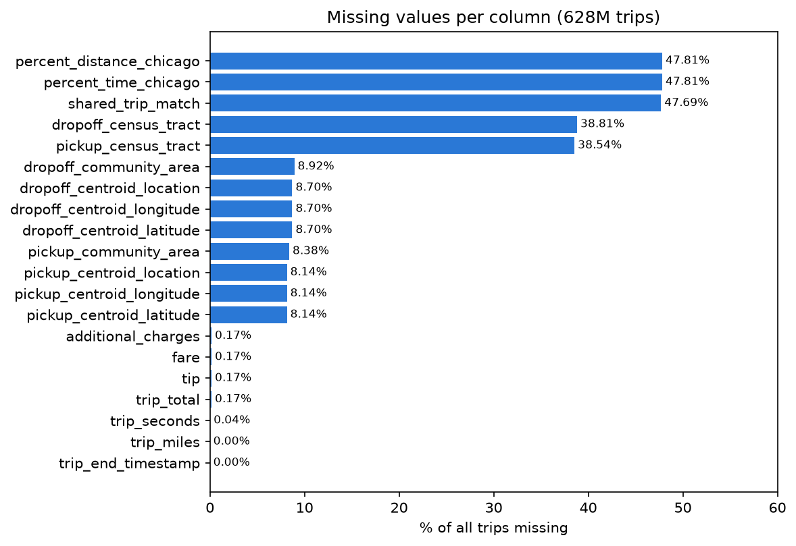

**Format and range checks.** Every pickup community area is between 1 and 77, every pickup point is inside the Chicago area, and `trip_total` always equals fare + tip + additional charges (within $1). Problems found:

| Check | Trips | % |
| --- | ---: | ---: |
| `trip_seconds` ≤ 0 | 1,989 | 0.0003 |
| `trip_miles` ≤ 0 | 201,123 | 0.032 |
| Longer than 4 hours | 8,312 | 0.001 |
| Longer than 100 miles | 140,325 | 0.022 |
| End time before start time | 228,072 | 0.036 |
| `trip_seconds` missing | 229,482 | 0.037 |
| Fare $0 or less | 3,817,627 | 0.61 |
| Fare above $500 | 1,074 | 0.0002 |
| `percent_time_chicago` above 1 | 114,578 | 0.018 |
| `percent_distance_chicago` above 1 | 6,525 | 0.001 |

The end-before-start and missing-`trip_seconds` counts are almost the same size, so they are probably mostly the same broken records; we use `trip_seconds`, not the rounded timestamps, for trip length.

**Descriptive statistics.** All money and distance features are strongly right-skewed (skewness 2.2 to 5.3), so the median describes a typical trip better than the mean.

| Feature | Mean | Std | Min | Q1 | Median | Q3 | 99th pct | Max | Skewness |
| --- | ---: | ---: | ---: | ---: | ---: | ---: | ---: | ---: | ---: |
| Trip time (s) | 1,117 | 806 | 0 | 553 | 900 | 1,452 | 3,870 | 86,130 | 2.2 |
| Trip distance (mi) | 6.88 | 7.68 | 0 | 2.0 | 4.1 | 9.0 | 34.6 | 1,881.9 | 4.0 |
| Fare ($) | 15.87 | 13.08 | 0 | 7.50 | 12.50 | 20.00 | 65.00 | 6,145 | 3.6 |
| Tip ($) | 1.09 | 2.72 | 0 | 0 | 0 | 0 | 13.00 | 500 | 4.7 |
| Additional charges ($) | 4.69 | 4.54 | 0 | 2.55 | 3.10 | 5.67 | 22.98 | 1,658.84 | 5.3 |
| Trip total ($) | 21.65 | 16.83 | 0 | 11.20 | 16.23 | 25.94 | 83.52 | 6,197.97 | 3.2 |

The typical trip takes 15 minutes, covers 4.1 miles and costs a $12.50 fare. Most trips have no tip. The maximum values are impossible for one city ride (23.9 hours, 1,881.9 miles, a $6,145 fare, `trips_pooled` = 4,097, `percent_time_chicago` = 4,208).

**Distributions.** 84% of cleaned trips take under 30 minutes and 57% are under 5 miles; the most common trip is 1–1.5 miles and 8–10 minutes. A second bump at 17–19 miles (3.8% of trips) is the distance from downtown to O'Hare. The fare histogram has no bars at $8, $18, $28 and so on because fares come in $2.50 steps.

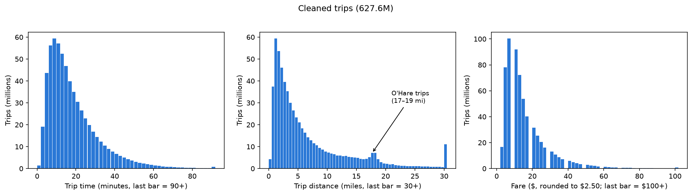

**Over time.** Before COVID, Chicago had about 9.3 million rideshare trips a month (peak: 10.3 million in March 2019). April 2020 fell to 1.5 million, 83% below April 2019. Trips recovered slowly and have stayed at about 7.2–8.2 million a month since 2024, still below 2019. Because of this break, the models use 2023 onward.

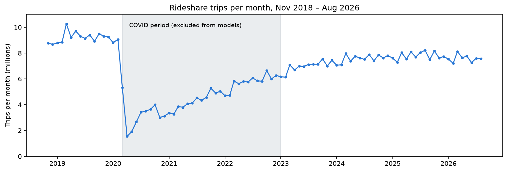

**Day and hour.** Weekdays have a morning peak at 8 AM and a bigger evening peak at 5–6 PM. Friday and Saturday evenings are the busiest hours of the week (about 7.5 million trips each at 7 PM), and Friday and Saturday nights stay busy past midnight. The quietest hour is 3 AM on a Tuesday. Saturday is the busiest day (114.5 million trips) and Monday the quietest (74.0 million).

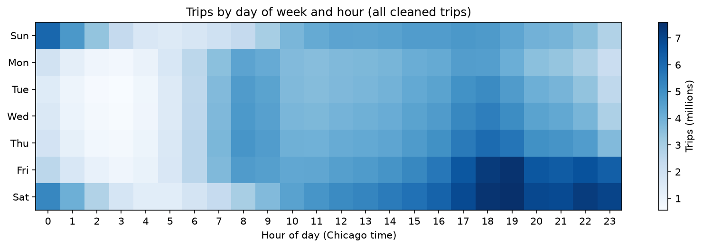

**Where trips start.** The Near North Side starts 89.6 million trips. The top 5 areas (Near North Side, Near West Side, Loop, Lake View, West Town) start 44% of trips with a known area, while the 38 least-used areas together start 10%. Hegewisch, Burnside and East Side start the fewest (under 0.4 million each). Raw counts mostly follow where people and jobs are, so the transit-gap score uses trips per person.

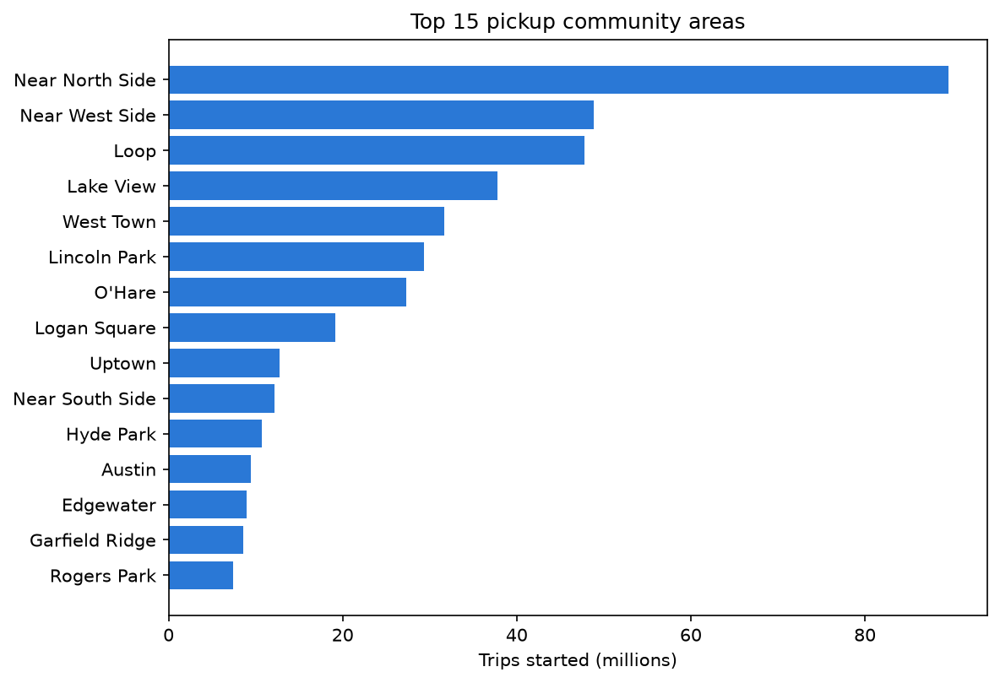

### Outliers

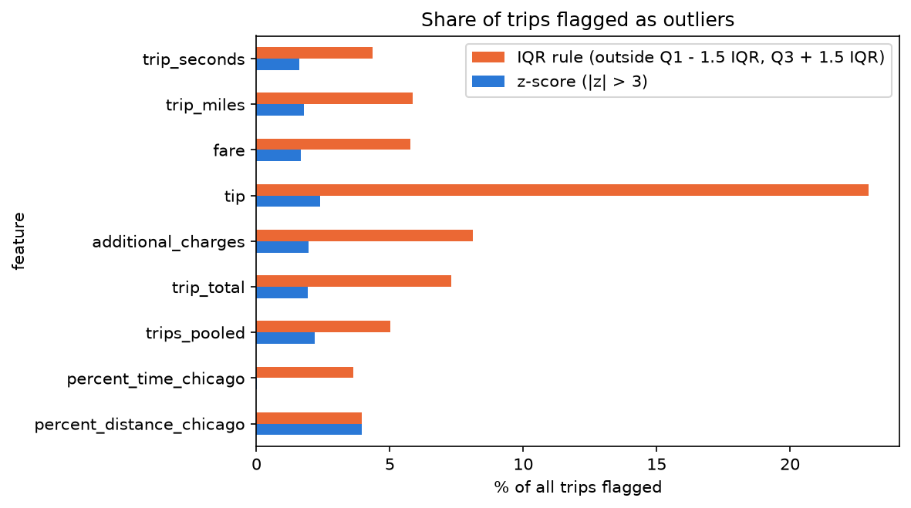

| Feature | IQR rule | z-score rule | Decision |
| --- | --- | --- | --- |
| Trip time | 4.4% (over 46.7 min) | 1.6% (over 58.9 min) | Keep: long trips are real (airports, suburbs); remove only over 4 hours or ≤ 0 s |
| Trip distance | 5.9% (over 19.5 mi) | 1.8% (over 29.9 mi) | Keep: the IQR fence would remove every O'Hare trip; remove only over 100 mi or ≤ 0 mi |
| Fare | 5.8% (over $38.75) | 1.7% (over $55.10) | Keep for trip counts; leave fares of $0 or above $500 out of price analysis |
| Tip | 23.0% (every tip above $0) | 2.4% (over $9.24) | Keep: the IQR rule is not meaningful because over 75% of trips have no tip |
| Additional charges, trip total | 8.1%, 7.3% | 2.0%, 1.9% | Keep: follow fare and distance |
| `trips_pooled` | 5.0% (any value but 1) | 2.2% | Keep for counts; values in the thousands are errors, not used in any model |
| `percent_time_chicago`, `percent_distance_chicago` | 3.6%, 3.9% (any value but 1) | 0.005%, 3.9% | Set values above 1 to missing; IQR is not meaningful (Q1 = Q3 = 1) |

On skewed data the two rules disagree a lot, and neither finds errors on its own: they flag long, real trips. We therefore keep statistical outliers and remove only values that are impossible for a city ride.

### Cleaning decisions

| Problem found | Trips | What we did |
| --- | ---: | --- |
| 0 seconds or 0 miles, missing time or distance, over 4 hours or over 100 miles | 582,711 (0.09%) | Removed; 627,606,969 trips remain |
| Fare $0 or less, or above $500 | 3,818,701 | Kept for trip counts; left out of fare analysis |
| Fare, tip and total missing | 1,060,418 | Kept for trip counts |
| `percent_time_chicago` or `percent_distance_chicago` above 1 | 114,578 / 6,525 | Set to missing |
| No pickup community area | 52,648,176 (8.4%) | Kept for city totals; left out of area analysis |
| No census tract | 38.5% | Analyze by community area instead of tract |
| Three columns only in 2023+ tables | — | Read with `mergeSchema`; empty before 2023 |
| Timestamps in local time | — | Spark session time zone set to America/Chicago on every job |

The same rules are applied in every analysis script (`build_area_hour.py`, `kmeans_areas.py`, `fpgrowth_routes.py`, `kmeans_validate.py`).

### Feature scaling

Trip time is in the hundreds to thousands of seconds while distance is in single miles and shares are between 0 and 1, so features are standardized (z-scores with `StandardScaler`) before K-means, and right-skewed counts are log-transformed (for example `log_trips_per_km2`). The gradient-boosted demand model splits on thresholds and does not need scaling.

### Spark execution on Managed Apache Spark

| | |
| --- | --- |
| Batch | `hshah82-trip-eda-1123b` (project `ride-or-rail-123456`, region `us-central1`), submitted by Harsh Shah |
| Runtime | Managed Apache Spark (Dataproc Serverless) 2.2, Spark 3.5; autoscaling, up to 4 executors |
| Driver and executors | 4 vCPU, 9.4 GB each |
| Duration | about 24 min for the batch, 22.9 min of Spark time |
| Spark jobs | 30 completed, 0 failed |
| Input | 37.8 GB of Parquet, 628,189,680 rows |

**Jobs list.** Job 1 is the one-pass diagnostics aggregation: one stage with 295 parallel tasks (one per Parquet input split) that took 3.3 minutes. The later jobs compute the quantiles, the outlier counts, the duplicate check and the category tables.

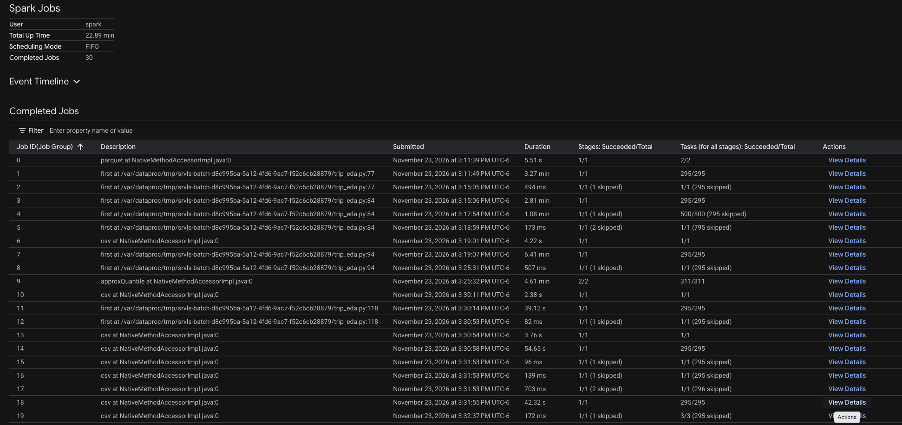

**Longest SQL query.** The query plan Spark ran for the largest step of the job.

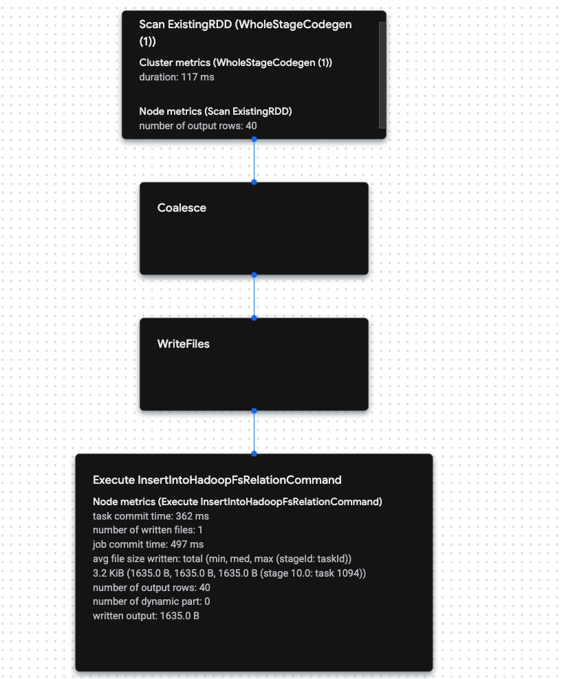

**Largest stage.** The stage with the most parallel tasks, with its DAG and task summary.

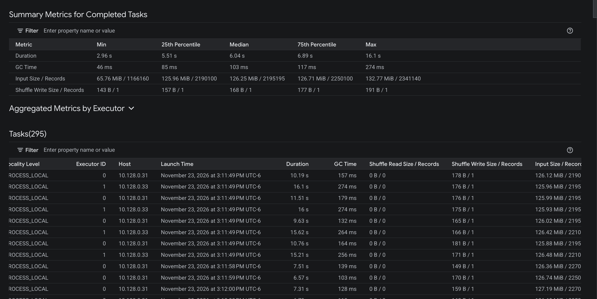

## Supporting datasets

### Method

`src/eda/supporting_eda.py` runs every check in Spark on all 7 supporting sources (8 files, 108 MB). It ran on Dataproc Serverless (runtime 2.2, Spark 3.5) as batch `shuss26-supporting-eda-1120` on Nov 20, 2026, in about 6 minutes. The CTA files are split into 16 MB input partitions, so each check runs as parallel tasks. For each source the job:

- reads the file as text, so it can count values that fail to parse as numbers or dates;
- checks missing values in every column, exact duplicate rows, duplicate keys, formatting and type problems, and value ranges;
- computes count, mean, standard deviation, min, quartiles, max and skewness for the selected features, and value counts for categorical ones;
- tests every numeric feature for outliers with both the IQR rule (outside Q1 − 1.5·IQR to Q3 + 1.5·IQR) and z-scores (|z| > 3);
- writes the cleaned data as Parquet to `gs://ride-or-rail-data-ride-or-rail-123456/results/eda_supporting/clean/`.

The summary tables are in `results/eda_supporting/`, and `notebooks/09_supporting_eda_spark.ipynb` plots them.

| Source | Rows | Features explored |
| --- | --- | --- |
| CTA 'L' daily entries (`5neh-572f`) | 1,333,391 | rides per station-day, daily system total, day type, year |
| CTA bus daily totals (`jyb9-n7fm`) | 1,120,604 | rides per route-day, daily system total, day type, routes |
| CTA 'L' stops (`8pix-ypme`) | 302 | latitude, longitude, lines served, ADA access |
| Community areas (`igwz-8jzy`) | 77 | area (km²), perimeter (km), geometry |
| Socioeconomic indicators 2008–2012 (`kn9c-c2s2`) | 78 | per capita income, poverty, unemployment, education, crowding, dependency, hardship |
| ACS 5-year by community area (`t68z-cikk`) | 77 | total population, households, share of households under $25k and $125k+ |
| NOAA daily weather, O'Hare and Midway | 39,991 | daily high and low, precipitation, snowfall, snow depth, wind (2018 onward) |

### Findings

**CTA ridership.** Since 2018 the 'L' carries a median of 290,012 rides a day and the bus system 465,000. Both distributions have two humps, before and after COVID. Rides per station are right-skewed (skewness 2.9): half of the 'L' station-days have fewer than 1,320 rides, while Lake/State averages about 10,000. Ride counts are written with thousands commas in 72% of 'L' rows and 79% of bus rows.


**'L' stops.** 302 platform-direction stops for 144 stations; all locations parse and lie in the Chicago region. Red and Blue have the most stops (66 each), Yellow the fewest (6), and 74% of stops are ADA accessible.


**Community areas.** All 77 areas, numbered 1–77 with no gaps. The median area is 7.4 km²; O'Hare (34.5 km²), South Deering (28.2 km²) and Austin (18.5 km²) are much larger.

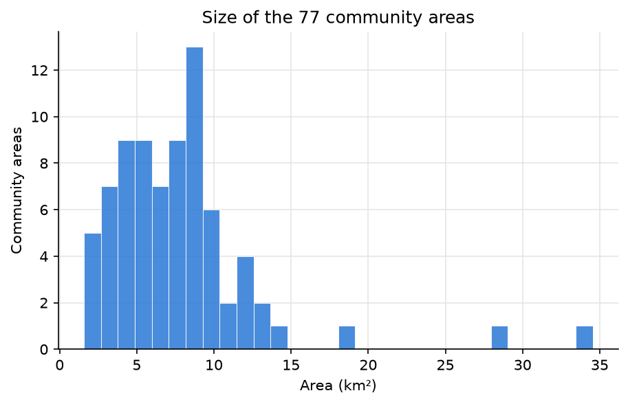

**Socioeconomic indicators.** After removing the city-wide row there are no missing values, and all percentages are in range. Per capita income is the most skewed feature (skewness 1.9): the median area has $21,323 and the Near North Side $88,669. Poverty goes from 3.3% to 56.5% of households.

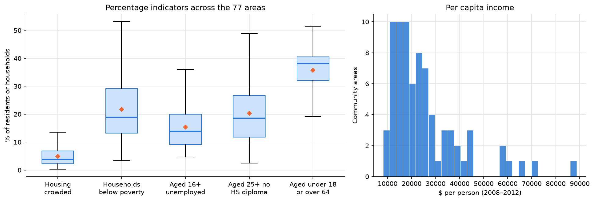

**ACS.** 77 areas, all from ACS 2023, with a median of 29,052 residents (largest: Austin, 100,278). The share of households earning under $25,000 goes from 2% to 52%.

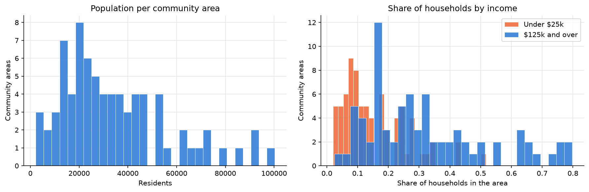

**Weather.** Both stations have every day since 2018 (3,217 days each) and no day with the low above the high. Midway does not record snowfall, so snow comes from O'Hare. The extremes are real: −30.5 °C during the January 2019 polar vortex and 89.7 mm of rain on May 14, 2020.

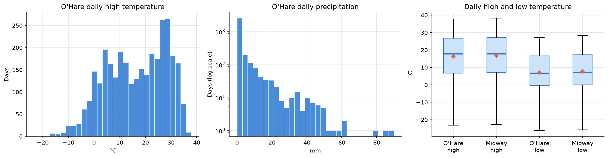

### Outliers

| Feature | IQR rule | z-score rule | Decision |
| --- | --- | --- | --- |
| 'L' rides per station-day | 7.2% high | 2.1% high | Keep: busiest downtown stations; use log scale |
| Bus rides per route-day | 3.5% high | 1.6% high | Keep: busiest routes |
| 'L' daily total | 55 days high (all 2018–2019) | none | Keep: pre-COVID days; models use 2023+ |
| 'L' stop latitude / longitude | 4 / 6 stops | 0 / 4 stops | Keep: real end-of-line stations (95th/Dan Ryan, O'Hare) |
| Community area size | 3 areas | 2 areas | Keep: real boundaries; compare per person or per km² |
| Per capita income | 6 areas | 2 areas | Keep: real differences; use log income or ranks |
| Population | 3 areas | none | Keep: real large areas |
| Daily temperature | 2 cold lows per station | 1–2 days per station | Keep: January 2019 polar vortex |
| Precipitation | 18% of days | 74 days (O'Hare) | Keep: heavy rain is real; IQR is not meaningful because most days are dry |

### Cleaning decisions

| Source | Problem found | What we did |
| --- | --- | --- |
| CTA 'L' and bus daily | Ride counts written with thousands commas | Removed the commas before casting to numbers |
| CTA 'L' daily | 618 station-days listed twice, all in 2011 | Kept one copy; outside our 2018+ window |
| CTA 'L' daily | Station 40140 renamed (Skokie → Dempster-Skokie) | Join on station id, not name |
| CTA 'L' daily | 3,851 zero-ride station-days since 2018 (closed stations) | Kept; real closures, not missing data |
| 'L' stops | Location stored as text "(lat, lon)" | Parsed into numeric latitude and longitude |
| Community areas | Area stored in square feet | Converted to km² |
| Socioeconomic | City-wide total row (CHICAGO) | Removed |
| ACS | Age/sex and race groups differ from the total by up to 2 people | Kept Total Population as published |
| Weather | Values in tenths of a unit, with leading spaces | Trimmed and converted to °C, mm and m/s |
| Weather | Midway has no snowfall data | Use O'Hare for snow |

No check found negative counts, unparseable dates, or duplicate keys in the 2018+ data.

### Feature scaling

Standard deviations range from about 0.1 (income shares) to about 22,000 (population), so numeric features are standardized (z-scores) before distance-based methods such as K-means, and right-skewed features (rides, income, population) are log-transformed. The gradient-boosted demand model does not need scaling.

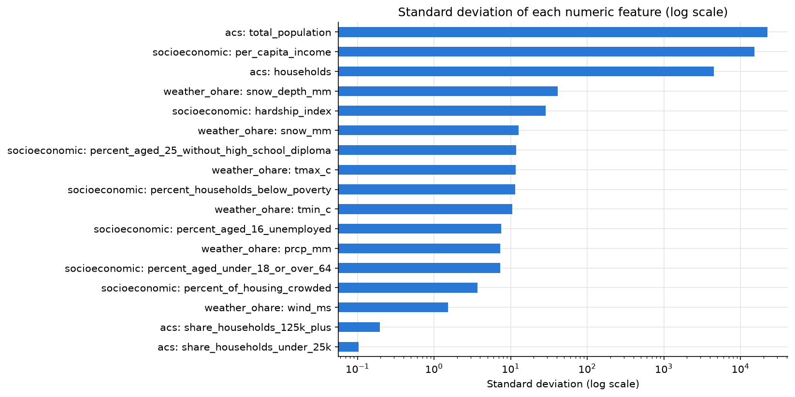

### Spark execution on Dataproc

| | |
| --- | --- |
| Batch | `shuss26-supporting-eda-1120` (project `ride-or-rail-123456`, region `us-central1`), submitted by Yousuf Hussain |
| Runtime | Dataproc Serverless 2.2.90 (Spark 3.5), autoscaling on |
| Driver and executors | 4 vCPU, 9.4 GB each; 2 executors to start |
| Duration | 6 min 47 s for the batch, 5.6 min of Spark time |
| Spark jobs | 322 completed, 0 failed |
| Cost | about 1.2 DCU-hours |

**Jobs list.** Each check is one or more Spark jobs; reading and counting the CTA files runs as 8 parallel tasks (one per 16 MB input partition).

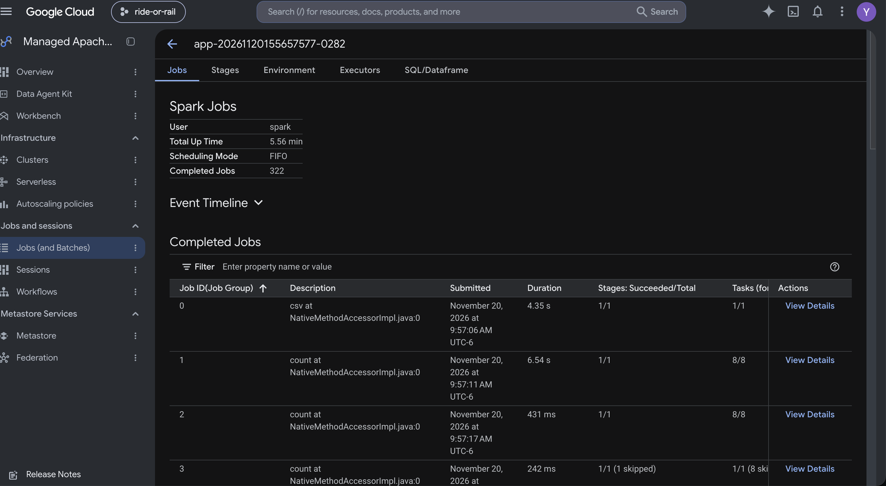

**Job 15: one stage with 1,000 parallel tasks.** This is the duplicate check on the 'L' file: Spark shuffles 33.4 MiB across 1,000 partitions so that each task handles a share of the station-days.

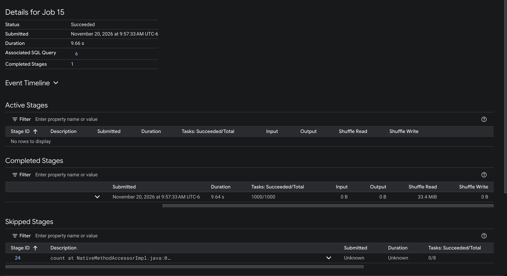

**Query 6 DAG (station names per station id).** Spark scans the cached 'L' data (1,333,391 rows), removes duplicate station-days with a sort-aggregate and an `Exchange` (shuffle) into 1,000 partitions, which leaves 1,332,773 rows (exactly 618 fewer, matching the duplicate-key check), and then counts names per station with two more hash-aggregate and shuffle steps.

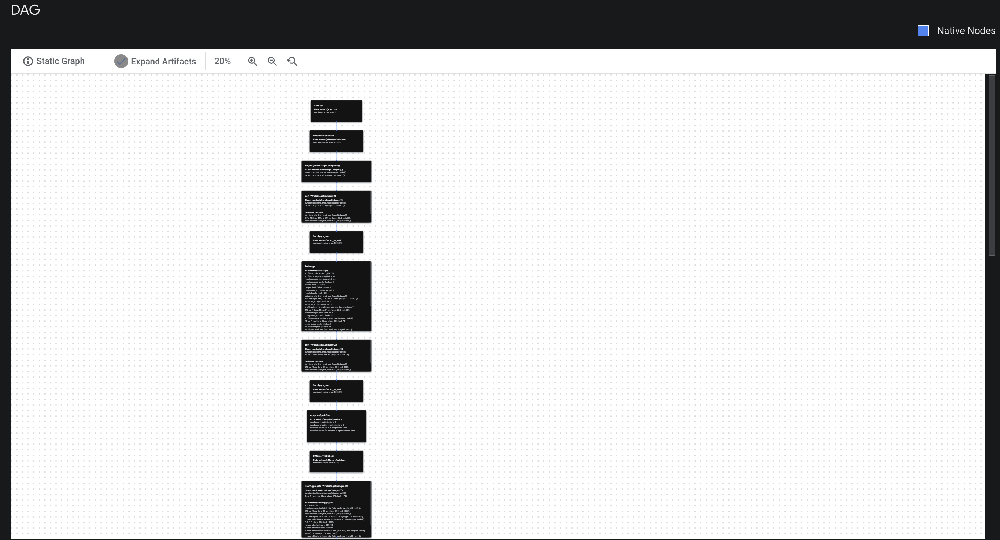

Exported physical plan for the same query (final plan from the Spark UI, abridged: expression ids and per-node metrics removed):

```
AdaptiveSparkPlan isFinalPlan=true
+- *(4) HashAggregate(keys=[], functions=[count(1)])
   +- Exchange SinglePartition
      +- *(3) HashAggregate(keys=[], functions=[partial_count(1)])
         +- *(3) Filter (n > 1)
            +- *(3) HashAggregate(keys=[station_id], functions=[count(distinct stationname)])
               +- AQEShuffleRead coalesced
                  +- Exchange hashpartitioning(station_id, 1000)
                     +- *(2) HashAggregate(keys=[station_id], functions=[partial_count(distinct stationname)])
                        +- *(2) HashAggregate(keys=[station_id, stationname])
                           +- AQEShuffleRead coalesced
                              +- Exchange hashpartitioning(station_id, stationname, 1000)
                                 +- *(1) HashAggregate(keys=[station_id, stationname])
                                    +- InMemoryTableScan [station_id, stationname]
                                       (cached: SortAggregate over Exchange hashpartitioning(station_id, date, 1000)
                                        <- FileScan csv gs://ride-or-rail-data-ride-or-rail-123456/inputs/supporting/cta_L_daily.csv)
```

**Query 0 DAG (reading the 'L' file header).** The first step of the job: Spark scans the 60.4 MiB CSV in Cloud Storage.

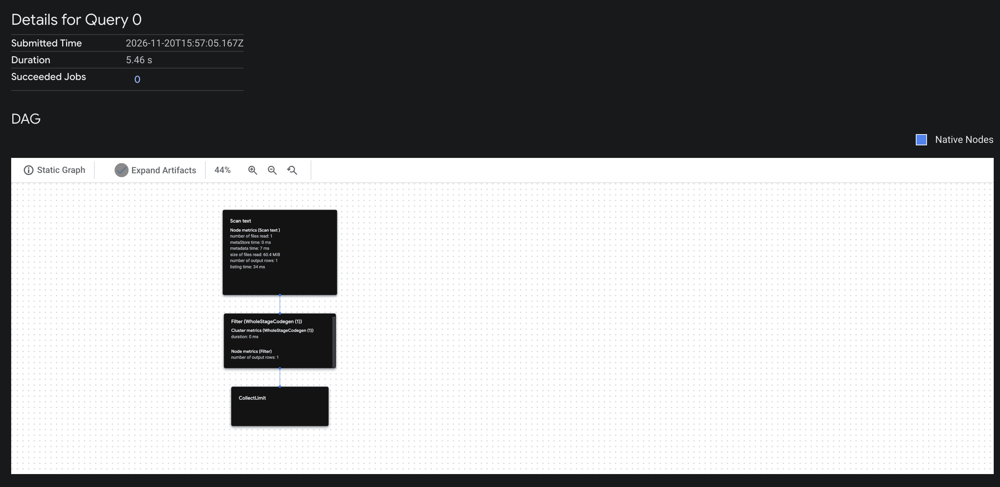
