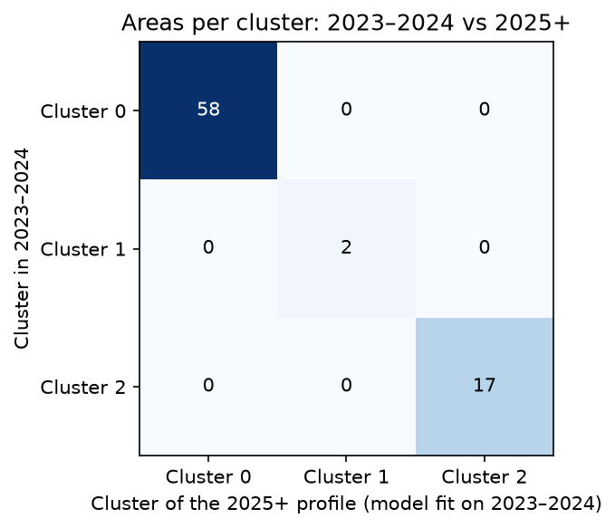
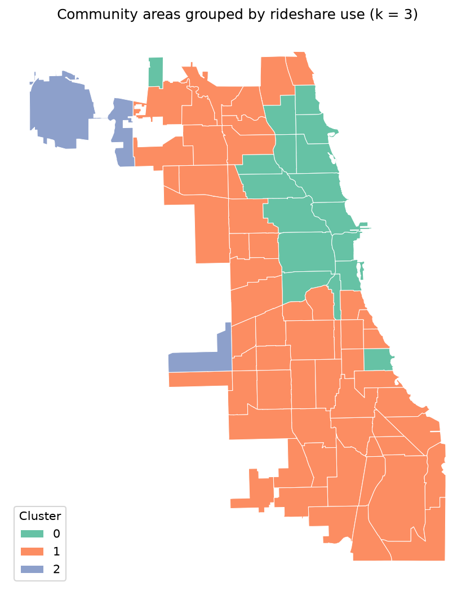
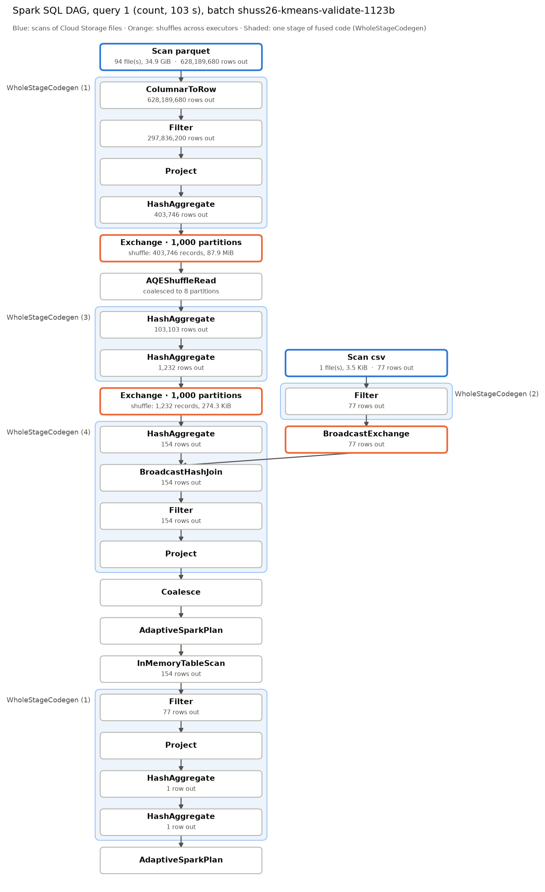
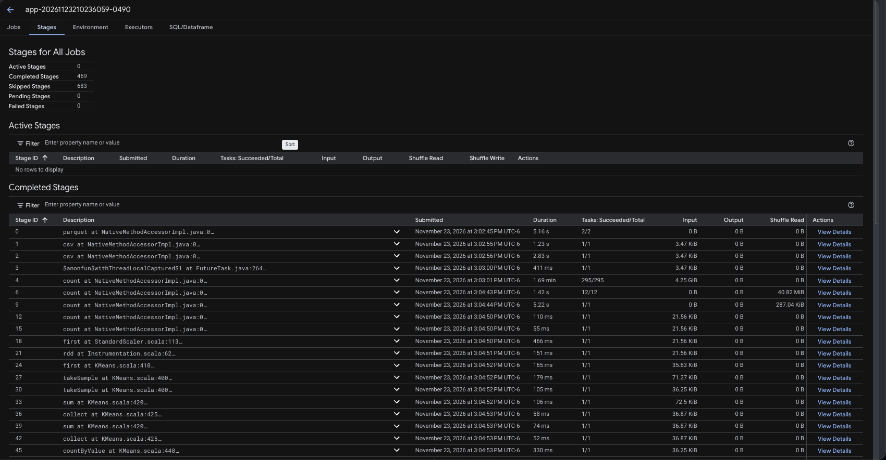

# Machine Learning – Ride or Rail?

This report covers Piazza Requirement 4: machine learning on the Chicago rideshare data, implemented in PySpark (`pyspark.ml`) and run in parallel on Google Cloud (Managed Apache Spark, formerly Dataproc Serverless). Each section states the research question, the method and why it fits, the features, how we split or validated the data, the metrics, the results with labeled charts, and the Spark DAGs from the cloud run.

| Analysis | Question | Method (`pyspark.ml`) | Owner | Code and notebook |
| --- | --- | --- | --- | --- |
| Demand model | How many rideshare trips will start in each community area in each hour? | `GBTRegressor`, time-based train/test split | Dharmik Patel | `src/models/demand_gbt.py`, `notebooks/07_demand_model.ipynb` |
| Area clusters | Which community areas use rideshare in similar ways? | `KMeans` + `StandardScaler`, silhouette, time hold-out, seed stability | Yousuf Hussain | `src/mining/kmeans_areas.py`, `src/models/kmeans_validate.py`, `notebooks/05_kmeans_areas.ipynb`, `notebooks/10_kmeans_validation.ipynb` |
| Frequent routes | Which trips (origin, destination, time, distance) happen together often, and do they follow the 'L'? | `FPGrowth`, support, confidence, lift | Harsh Shah | `src/mining/fpgrowth_routes.py`, `notebooks/06_fp_routes.ipynb` |
| Transit-gap score | Which areas have high rideshare use and poor transit? | Combines the results above with CTA access and income | Harsh Shah | `notebooks/09_transit_gap_score.ipynb` |

All analyses use the cleaned trips from `EDA.md` (trips with 0 seconds or 0 miles, over 4 hours or over 100 miles removed) and only 2023 onward, after the COVID break. Times are in Chicago local time (`spark.sql.session.timeZone = America/Chicago`).

## 1. Demand model (GBT regression)

To be added by Dharmik.

## 2. Area clusters (K-means)

**Question.** Which community areas use rideshare in similar ways, and do those groups last over time?

**Method and why it fits.** K-means (`pyspark.ml.clustering.KMeans`) on standardized area profiles (`pyspark.ml.feature.StandardScaler`). There is no label for "kind of area", so this is an unsupervised grouping problem, and K-means gives a few groups that are easy to describe and to compare with 'L' access. We use k = 3, chosen in `notebooks/05_kmeans_areas.ipynb` with the elbow and the silhouette score (k = 3 had the highest silhouette, 0.643).

**Features.** One profile per pickup community area, built in Spark from all cleaned trips with a known pickup area; the same 12 features as `src/mining/kmeans_areas.py`:

| Feature | What it measures |
| --- | --- |
| `share_night`, `share_morning`, `share_midday`, `share_evening`, `share_late` | Share of the area's trips that start at 0–5, 6–9, 10–15, 16–19 and 20–23 h |
| `share_weekend` | Share on Saturdays and Sundays |
| `share_to_downtown` | Share that end in the Loop, Near North Side or Near West Side |
| `share_to_airport` | Share that end at O'Hare or Garfield Ridge (Midway) |
| `share_same_area` | Share that start and end in the same area |
| `avg_miles`, `avg_fare` | Average trip length and average fare (fares above $0) |
| `log_trips_per_km2` | log10 of trips per km² per day: how busy the area is (log, because density is very skewed) |

We chose them to describe *when*, *where to* and *how far* people ride, which is what separates nightlife, commuting and airport trips, plus how busy each area is. All 12 are standardized because their scales differ by orders of magnitude (see "Feature scaling" in `EDA.md`).

**Validation instead of accuracy.** K-means has no labels to score, so `src/models/kmeans_validate.py` checks two things on Managed Apache Spark:

1. *Best of 20 restarts:* fit k = 3 on the 2023–2024 profiles with seeds 1 to 20, keep the seed with the best silhouette, and compare every seed's grouping with it using the adjusted Rand index (ARI: 1 = identical grouping, 0 = no better than chance).
2. *Time hold-out (train/test split):* the scaler and the best model are fit on 2023–2024 only (train), then each area's Jan 2025 – Aug 2026 profile (test) is put into its nearest cluster. We report how many areas keep their cluster, the ARI between the two periods and the silhouette score of the test profiles.

**Results** (`notebooks/10_kmeans_validation.ipynb`, batch `shuss26-kmeans-validate-1123b`):

| Metric | Value |
| --- | --- |
| Best seed (of 20) | 1, silhouette 0.646 on 2023–2024 |
| Seeds that find the same clusters (ARI > 0.99) | 8 of 20 (1, 4, 8, 9, 10, 13, 15, 16); seed 3 is almost the same (ARI 0.976) |
| Silhouette over the 20 seeds | 0.279 to 0.646 (mean 0.567) |
| Areas that keep their cluster in 2025+ | 77 of 77 (100%) |
| ARI, 2023–2024 vs 2025+ | 1.000 |
| Silhouette of 2025+ under the 2023–2024 model | 0.640 |

- **The clusters last.** Every area keeps its cluster from 2023–2024 to 2025+, and the new data is separated almost as well (0.640 vs 0.646).
- **They are the M2 clusters.** The best 2023–2024 model gives exactly the three groups in `notebooks/05_kmeans_areas.ipynb`: 17 central and lakefront areas (evening, late-night and weekend trips), 58 areas in the rest of the city (daytime, everyday trips) and the 2 airports. All 77 areas match; only the cluster numbers differ, because K-means numbers its clusters in no particular order.
- **The starting point matters.** 12 of the 20 seeds stop in weaker solutions, down to a silhouette of 0.279. Our first run (`shuss26-kmeans-validate-1123`) used seed 42, which landed on one of them (silhouette 0.571, with downtown in the same cluster as the airports), so we now keep the best of 20 restarts. Spark's K-means also gave different results for the same seed in the two runs (seed 7: 0.646, then 0.521), so one fixed seed is not enough to reproduce a result.

**Limitations.** Each area is one average profile per period, so this shows that the overall pattern is stable, not that every area behaves the same every month. The test period is 20 months, and k = 3 was chosen on all 2023+ data, not re-chosen on the training years only.

**Spark execution and DAGs.** Both runs read all 628,189,680 trips (34.9 GiB of Parquet in 94 files) from Cloud Storage. The filter keeps 297,836,200 cleaned trips from 2023 onward, and a shuffle into 1,000 partitions reduces them to 154 area profiles (77 areas × 2 periods) before K-means runs.

The DAG of the main query of the final run (query 1, 103 s), exported from the Spark UI's data with `src/cloud/spark_dag.py`, since the UI graph is too tall to screenshot legibly:

Spark UI screenshots of the first run: 349 jobs, and 469 completed stages with none failed; stage 4 read 4.25 GiB of trips with 295 parallel tasks.

## 3. Frequent routes (FP-Growth)

To be added by Harsh.

## 4. From results to the transit-gap score

To be added by Harsh.

## Spark execution on Managed Apache Spark

| Batch | Script | Submitted by | Duration | Notes |
| --- | --- | --- | --- | --- |
| `shuss26-kmeans-validate-1123` | `src/models/kmeans_validate.py` (first version: hold-out with seed 42) | Yousuf Hussain | 4 min 24 s | 349 Spark jobs, 469 stages, none failed; showed that seed 42 is a weaker solution (silhouette 0.571) |
| `shuss26-kmeans-validate-1123b` | `src/models/kmeans_validate.py` (best of 20 seeds) | Yousuf Hussain | 4 min 13 s | 338 Spark jobs, 457 stages; final results in section 2 |

Each owner adds a row for their batch and the DAG screenshots in their own section. To draw the DAG of any batch's longest query: `python src/cloud/spark_dag.py <batch id> docs/figures/ml/<name>.png` (add a query number to pick another query).
