# Machine Learning – Ride or Rail?

This report covers Piazza Requirement 4: machine learning on the Chicago rideshare data, implemented in PySpark (`pyspark.ml`) and run in parallel on Google Cloud (Managed Apache Spark, formerly Dataproc Serverless). Each section states the research question, the method and why it fits, the features, how we split or validated the data, the metrics, the results with labeled charts, and the Spark DAGs from the cloud run.

| Analysis | Question | Method (`pyspark.ml`) | Owner | Code and notebook |
| --- | --- | --- | --- | --- |
| Demand model | How many rideshare trips will start in each community area in each hour? | `GBTRegressor`, time-based train/test split | Dharmik Patel | `src/models/demand_gbt.py`, `notebooks/07_demand_model.ipynb` |
| Area clusters | Which community areas use rideshare in similar ways? | `KMeans` + `StandardScaler`, silhouette, time hold-out, seed stability | Yousuf Hussain | `src/mining/kmeans_areas.py`, `src/models/kmeans_validate.py`, `notebooks/05_kmeans_areas.ipynb`, `notebooks/10_kmeans_validation.ipynb` |
| Frequent routes | Which trips (origin, destination, time, distance) happen together often, and do they follow the 'L'? | `FPGrowth`, support, confidence, lift | Harsh Shah | `src/mining/fpgrowth_routes.py`, `notebooks/06_fp_routes.ipynb` |
| Transit-gap score | Which areas have high rideshare use and poor transit? | Combines the results above with CTA access and income | Harsh Shah | `notebooks/09_transit_gap_score.ipynb` |

All analyses use the cleaned trips from `EDA.md` (trips with 0 seconds or 0 miles, over 4 hours or over 100 miles removed) and only 2023 onward, after the COVID break. Times are in Chicago local time (`spark.sql.session.timeZone = America/Chicago`).

## 1. Demand model (GBT regression)

**Question.** How many rideshare trips will start in each community area in each hour, and can a machine-learning model predict this better than simple rules?

**Method and why it fits.** Gradient-boosted trees for regression (`pyspark.ml.regression.GBTRegressor`, 50 trees, depth 6, learning rate 0.1, 80% row subsampling, `maxBins` 96 so that each of the 77 areas can get its own split). The target is a count with strong, non-linear interactions (the same hour behaves differently by area and day of week), which trees handle without manual feature engineering, and they need no feature scaling. We compare it with two simple baselines that a transit planner could use without a model: the same hour one week earlier, and the average of the same hour over the last 4 weeks.

**Data.** The community area × hour feature table (`src/features/build_area_hour.py`, 2023 onward), expanded to every area × date × hour so that hours with no trips count as 0 (a model trained only on hours with trips would never predict a quiet hour).

**Features.**

| Feature | Why |
| --- | --- |
| `area`, `hour`, `dow`, `month`, `is_weekend` | Where and when: the daily and weekly cycle and the season |
| `is_holiday` | CTA marks Sundays and holidays as "U"; a "U" that is not a Sunday is a holiday |
| `tmax_c`, `tmin_c`, `prcp_mm`, `snow_mm` | Daily weather at O'Hare (NOAA) |
| `lag_1d`, `lag_7d`, `avg_4w` | Trips in the same area and hour 1 day, 7 days and on average 1–4 weeks earlier |

We leave out average distance, fare, the `share_*` columns and same-day CTA ridership: they are only known after the hour is over, so using them would leak the answer.

**Train/test split.** By time, not at random: train on Feb 2023 – Jun 2025 (1,628,088 area-hours), test on Jul 2025 – Aug 2026 (789,096 area-hours). A random split would let the model learn from hours after the ones it predicts. January 2023 is used only to build the 4-week lags.

**Metrics.** RMSE (penalizes large misses at busy hours), MAE (typical error in trips per area-hour) and R² on the test period.

**Results** (`src/models/demand_gbt.py`, `notebooks/07_demand_model.ipynb`):

| Model | RMSE | MAE | R² |
| --- | ---: | ---: | ---: |
| Baseline: same hour last week | 74.36 | 22.49 | 0.921 |
| Baseline: average of last 4 weeks | 60.48 | 19.02 | 0.948 |
| **Gradient-boosted trees** | **53.60** | **18.03** | **0.959** |

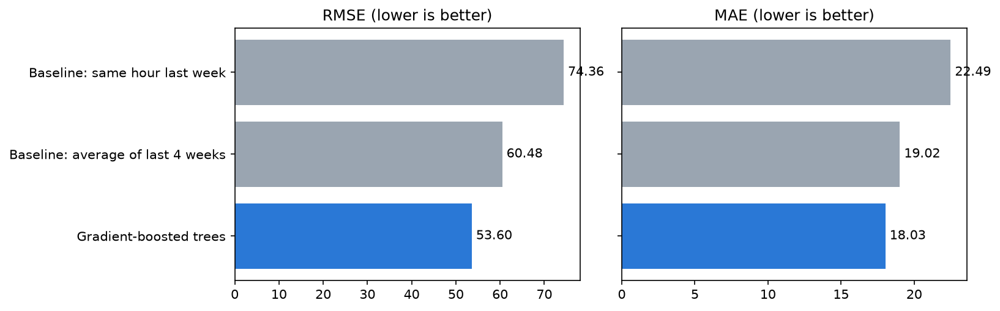

- **The model beats both baselines**: 11.4% lower RMSE and 5.2% lower MAE than the 4-week average. The gain is moderate because demand is very regular (the 4-week average alone explains about 95% of the variation); the larger drop in RMSE shows that the model mainly reduces big misses at busy hours.
- **Demand is mostly habit.** The 4-week average carries 0.74 of the feature importance, then the previous day (0.06), area (0.05), hour (0.04) and day of week (0.04). All weather features together add only 0.03 and holidays 0.01.

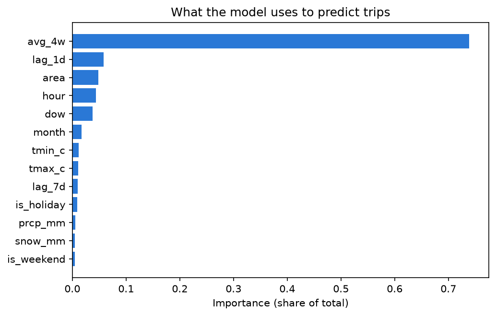

- **It follows the daily cycle but misses unusual hours.** In the first two test weeks it tracks the Near North Side, Austin and O'Hare closely, but it underestimates the July 4 evening in Austin and the return-travel spike at O'Hare on Sunday July 6 (about 1,500 trips against about 850 predicted). One week after the holiday it does better than "same hour last week", which copies the holiday pattern into a normal week.

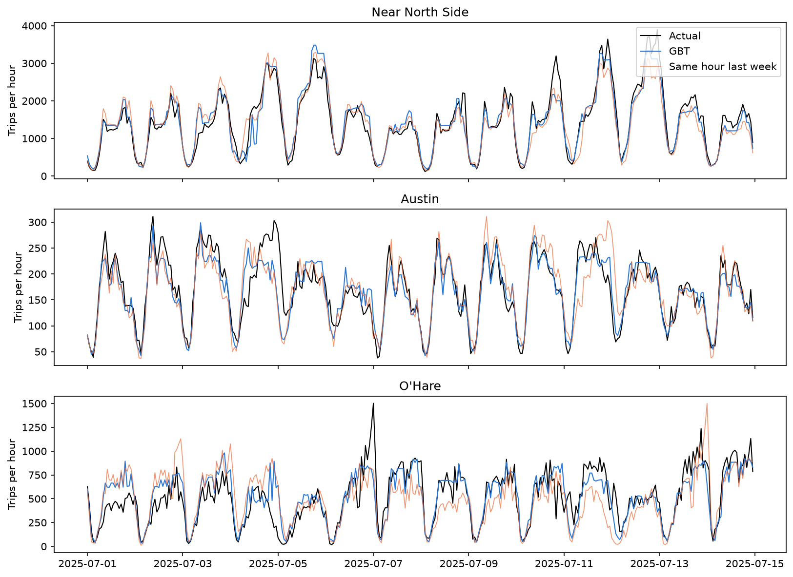

- **Errors are about 12–13% of average demand in the busiest areas** (Near North Side 11.8%, Near West Side 12.2%, Loop 12.8%) with almost no bias (Near North Side: 1,417 predicted vs 1,397 actual trips per hour on average). They are larger where demand depends on flights and events: O'Hare 18.8%, Garfield Ridge (Midway) 21.6%, Near South Side (McCormick Place, Soldier Field) 24.2%.

**Limitations.** The model needs the last 4 weeks and the previous day of trips, so it predicts one day ahead, not months ahead. It does not know about events or flight schedules, so it misses holiday and event spikes, and the weather is one station for the whole city.

**How we use it.** The predicted demand per area and hour (`results/model/area_hour_profile.csv`) feeds the hourly demand chart in the dashboard, so a planner can see at which hours a transit-gap area needs service most.

**Spark execution and DAGs.** The model ran on Managed Apache Spark (batch `dpate497-demand-gbt-1124`) on the 2.4 million area-hour rows. Spark builds the full area × date × hour grid with a cross join, fills the lags with window functions partitioned by area and hour (one shuffle), and trains the 50 trees in parallel across the executors.

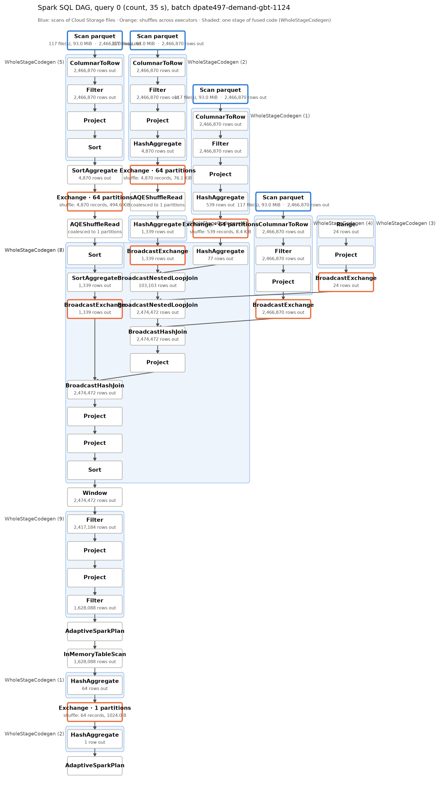

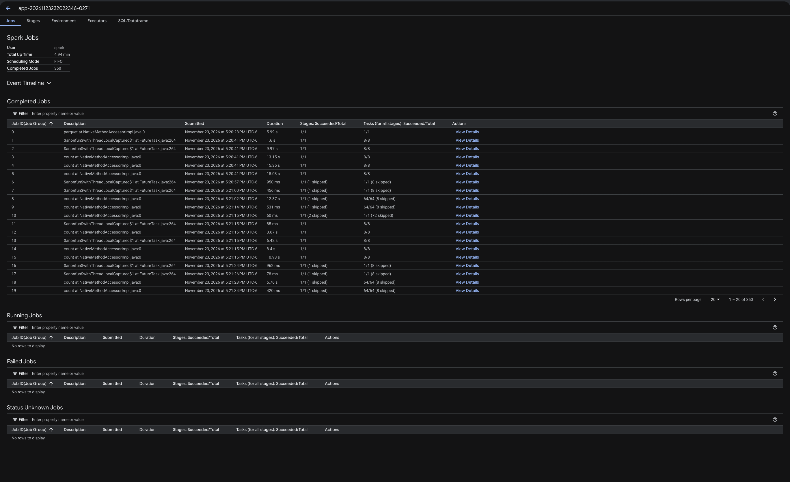

## 2. Area clusters (K-means)

**Question.** Which community areas use rideshare in similar ways, and do those groups last over time?

**Method and why it fits.** K-means (`pyspark.ml.clustering.KMeans`) on standardized area profiles (`pyspark.ml.feature.StandardScaler`). There is no label for "kind of area", so this is an unsupervised grouping problem, and K-means gives a few groups that are easy to describe and to compare with 'L' access. We use k = 3, chosen in `notebooks/05_kmeans_areas.ipynb` with the elbow and the silhouette score (k = 3 had the highest silhouette, 0.643).

**Features.** One profile per pickup community area, built in Spark from all cleaned trips with a known pickup area; the same 12 features as `src/mining/kmeans_areas.py`:

| Feature | What it measures |
| --- | --- |
| `share_night`, `share_morning`, `share_midday`, `share_evening`, `share_late` | Share of the area's trips that start at 0–5, 6–9, 10–15, 16–19 and 20–23 h |
| `share_weekend` | Share on Saturdays and Sundays |
| `share_to_downtown` | Share that end in the Loop, Near North Side or Near West Side |
| `share_to_airport` | Share that end at O'Hare or Garfield Ridge (Midway) |
| `share_same_area` | Share that start and end in the same area |
| `avg_miles`, `avg_fare` | Average trip length and average fare (fares above $0) |
| `log_trips_per_km2` | log10 of trips per km² per day: how busy the area is (log, because density is very skewed) |

We chose them to describe *when*, *where to* and *how far* people ride, which is what separates nightlife, commuting and airport trips, plus how busy each area is. All 12 are standardized because their scales differ by orders of magnitude (see "Feature scaling" in `EDA.md`).

**Validation instead of accuracy.** K-means has no labels to score, so `src/models/kmeans_validate.py` checks two things on Managed Apache Spark:

1. *Best of 20 restarts:* fit k = 3 on the 2023–2024 profiles with seeds 1 to 20, keep the seed with the best silhouette, and compare every seed's grouping with it using the adjusted Rand index (ARI: 1 = identical grouping, 0 = no better than chance).
2. *Time hold-out (train/test split):* the scaler and the best model are fit on 2023–2024 only (train), then each area's Jan 2025 – Aug 2026 profile (test) is put into its nearest cluster. We report how many areas keep their cluster, the ARI between the two periods and the silhouette score of the test profiles.

**Results** (`notebooks/10_kmeans_validation.ipynb`, batch `shuss26-kmeans-validate-1123b`):

| Metric | Value |
| --- | --- |
| Best seed (of 20) | 1, silhouette 0.646 on 2023–2024 |
| Seeds that find the same clusters (ARI > 0.99) | 8 of 20 (1, 4, 8, 9, 10, 13, 15, 16); seed 3 is almost the same (ARI 0.976) |
| Silhouette over the 20 seeds | 0.279 to 0.646 (mean 0.567) |
| Areas that keep their cluster in 2025+ | 77 of 77 (100%) |
| ARI, 2023–2024 vs 2025+ | 1.000 |
| Silhouette of 2025+ under the 2023–2024 model | 0.640 |

- **The clusters last.** Every area keeps its cluster from 2023–2024 to 2025+, and the new data is separated almost as well (0.640 vs 0.646).
- **They are the M2 clusters.** The best 2023–2024 model gives exactly the three groups in `notebooks/05_kmeans_areas.ipynb`: 17 central and lakefront areas (evening, late-night and weekend trips), 58 areas in the rest of the city (daytime, everyday trips) and the 2 airports. All 77 areas match; only the cluster numbers differ, because K-means numbers its clusters in no particular order.
- **The starting point matters.** 12 of the 20 seeds stop in weaker solutions, down to a silhouette of 0.279. Our first run (`shuss26-kmeans-validate-1123`) used seed 42, which landed on one of them (silhouette 0.571, with downtown in the same cluster as the airports), so we now keep the best of 20 restarts. Spark's K-means also gave different results for the same seed in the two runs (seed 7: 0.646, then 0.521), so one fixed seed is not enough to reproduce a result.

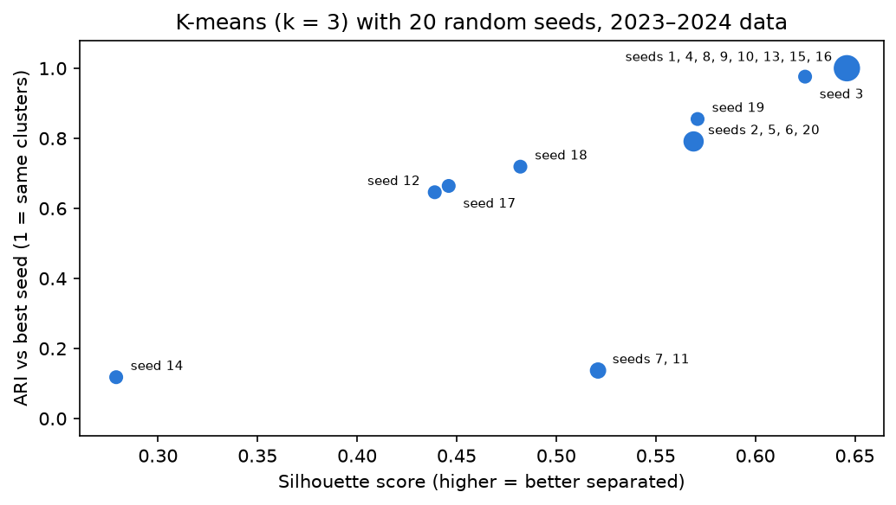

**Limitations.** Each area is one average profile per period, so this shows that the overall pattern is stable, not that every area behaves the same every month. The test period is 20 months, and k = 3 was chosen on all 2023+ data, not re-chosen on the training years only.

**Spark execution and DAGs.** Both runs read all 628,189,680 trips (34.9 GiB of Parquet in 94 files) from Cloud Storage. The filter keeps 297,836,200 cleaned trips from 2023 onward, and a shuffle into 1,000 partitions reduces them to 154 area profiles (77 areas × 2 periods) before K-means runs.

The DAG of the main query of the final run (query 1, 103 s), exported from the Spark UI's data with `src/cloud/spark_dag.py`, since the UI graph is too tall to screenshot legibly:

Spark UI screenshots of the first run: 349 jobs, and 469 completed stages with none failed; stage 4 read 4.25 GiB of trips with 295 parallel tasks.

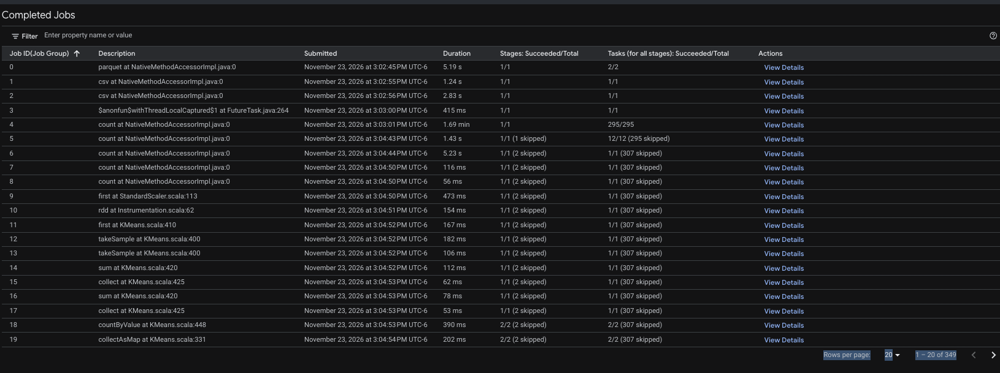

## 3. Frequent routes (FP-Growth)

**Question.** Which combinations of origin, destination, time of day, day type and trip length happen together often, and do the busiest routes follow an 'L' line?

**Method and why it fits.** FP-Growth (`pyspark.ml.fpm.FPGrowth`) finds frequent itemsets and association rules without generating candidate sets, so it scales to millions of baskets in parallel. Our question is about which trip features occur *together*, which is exactly what itemsets and rules describe; there is no target to predict. Exact origin–destination counts on all trips complement it.

**Features (items).** Each cleaned 2023+ trip with both community areas known becomes a basket of 5 items:

| Item | Values |
| --- | --- |
| `from=` | pickup community area (1–77) |
| `to=` | dropoff community area (1–77) |
| `time=` | night (0–5 h), morning (6–9), midday (10–15), evening (16–19), late (20–23) |
| `day=` | weekday, weekend |
| `dist=` | 0–2 mi, 2–5 mi, 5–10 mi, 10+ mi |

Time, day and distance are banded because FP-Growth needs categories; the bands match the K-means time shares. Thresholds: minimum support 0.2% and minimum confidence 10%, on a 10% random sample to keep the cost down.

**M2 results** (`src/mining/fpgrowth_routes.py`, `notebooks/06_fp_routes.ipynb`, batch `b46bb9c677ee497b8ba2783626a9ce7a`): 266,341,936 trips for the exact route counts, 26,634,942 sampled baskets, 2,098 frequent itemsets and 4,234 rules. Of the 50 busiest routes between different areas, 30 can be made on one 'L' line without a transfer and carry 64% of the trips on those routes (Loop ↔ O'Hare alone: about 3.4 million trips along the Blue Line). The busiest routes with no single 'L' line (Near North Side ↔ Near West Side, Near North Side ↔ West Town, Near North Side ↔ O'Hare) feed the transfer part of the transit-gap score.

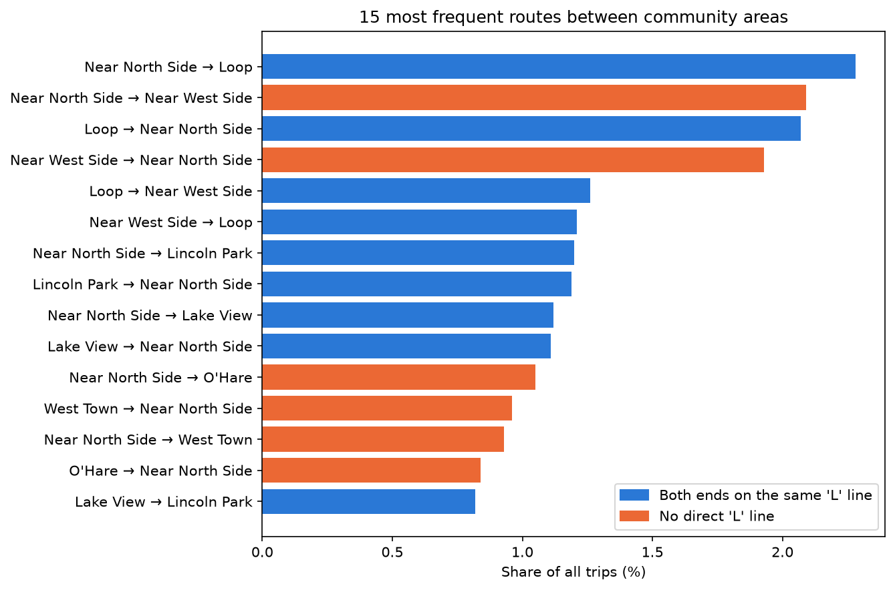

**Validation: time hold-out (train/test split).** Rules have no labels to score, so `src/models/fpgrowth_validate.py` checks whether the rules found on one period still hold later:

1. *Train:* FP-Growth on a 10% sample of 2023–2024 trips (14,258,642 baskets), same items and thresholds.
2. *Test:* a 10% sample of Jan 2025 – Aug 2026 trips (12,376,300 baskets). Each test basket is expanded into its 31 item combinations in one pass (383.7 million rows), counted, and joined to the rules to recompute each rule's support, confidence and lift.
3. *Metric:* a rule **holds** if its test confidence is still at least 10% and its test lift is still above 1. We also report how much confidence changes and the correlation of confidence and log lift between the two periods.

**Results** (`notebooks/12_fp_validation.ipynb`, batch `hshah82-fpgrowth-validate-1123`):

| Metric | Value |
| --- | --- |
| Rules found on 2023–2024 | 4,217 |
| Rules that still hold on 2025+ | 3,026 (71.8%) |
| Rules with lift > 1 in training that still hold | 2,975 of 3,017 (98.6%) |
| Rules with lift > 1.5 in training that still hold | 1,173 of 1,179 (99.5%) |
| Rules still frequent (support ≥ 0.2%) on 2025+ | 4,102 (97.3%) |
| Mean change in confidence | 0.007 |
| Correlation of confidence, train vs test | 0.999 |
| Correlation of log lift, train vs test | 0.999 |

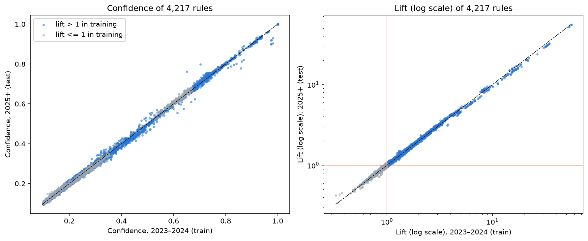

- **The rules last.** Confidence and lift barely change between the two periods (points on the diagonal). Short trips that end in Austin start in Austin 80% of the time in both periods (lift 56 and 55); long trips that end in the Loop come from O'Hare 48% then 52% of the time.
- **Almost all "failures" were never real associations.** A minimum confidence of 10% lets through rules whose lift is below 1, where the items appear together *less* often than by chance (for example a common item such as `day=weekday` predicted from a rarer one). 1,200 of the 4,217 rules were like this already in training, and they are 1,149 of the 1,191 rules that fail. Only 20 rules fail because their confidence fell below 10%. From now on we report only rules with lift above 1.

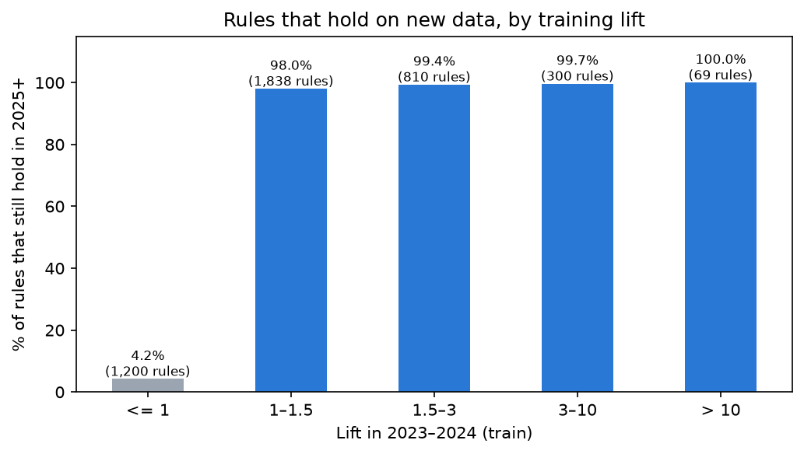

**Limitations.** Both periods use 10% samples, so rules near the 0.2% support threshold carry some sampling noise, and rules with very high lift often involve a rare single-area item (a short trip inside Austin), so we read lift together with support and confidence.

**Spark execution and DAGs.** The test-side counting is the heaviest step: 12.4 million cached test baskets are expanded to 383.7 million item combinations (`Generate`), aggregated to 9.6 million partial counts, shuffled into 1,000 partitions (629.6 MiB) and reduced to under 300,000 distinct itemsets, which are joined three times (A, C and A + C) to the 4,217 rules with sort-merge joins. Drawn with `src/cloud/spark_dag.py`:

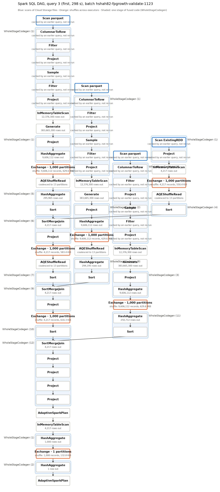

FP-Growth itself runs on Spark's RDD API inside `pyspark.ml`, so it does not appear as a SQL query; the longest SQL query of the M2 run is the step that writes the 2,098 itemsets (2,098 rows through one shuffle):

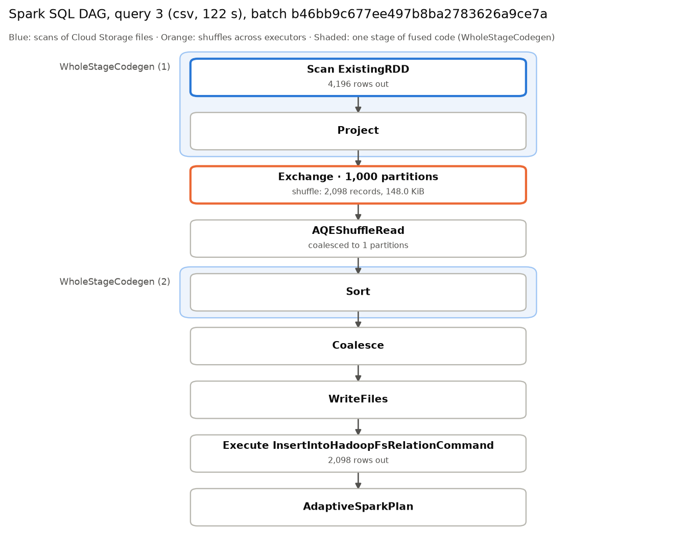

## 4. From results to the transit-gap score

**Question.** Which community areas most likely have a transit gap: poor transit, high need, and common trips that the 'L' does not serve directly?

**How the ML results feed it.** The score (`notebooks/09_transit_gap_score.ipynb`, issue #16) combines four parts per area, each standardized as a z-score, weighted, and rescaled to 0–100 (100 = biggest gap). It is computed in pandas on the 77-row outputs of the Spark jobs; the heavy work (trip counts, routes, clusters) is done in Spark.

| Part | Measure | Weight | Comes from |
| --- | --- | --- | --- |
| Poor transit access | Distance from the area center to the nearest 'L' station | 0.35 | CTA access (`notebooks/04_cta_access.ipynb`) |
| Need | Hardship index (2008–2012) | 0.25 | Socioeconomic data (`notebooks/08_population_income.ipynb`) |
| Reliance on rideshare | Trips per person per year (log) | 0.20 | Spark trip counts per area |
| Transfer burden | Share of the area's busiest trips with no direct 'L' line | 0.20 | FP-Growth exact route counts (section 3) |

O'Hare is left out (an airport with about 16,000 residents). The K-means clusters (section 2) are used to describe the result.

**Results.** The highest scores are all on the Far South Side: Riverdale (100), Hegewisch (87.4), South Chicago (82.4), South Deering (78.0) and West Pullman (75.6). All 15 top areas are in the daytime, everyday K-means cluster, and none of their busiest routes has a direct 'L' line.

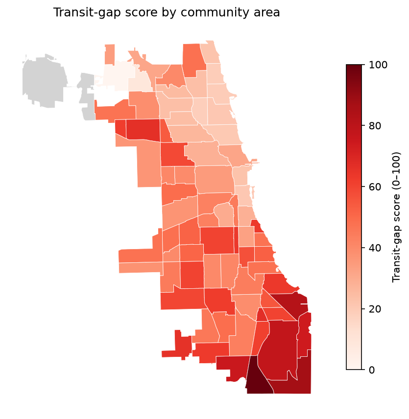

**Validation.** There are no true labels for "transit gap", so we test how much the ranking depends on our weights: with equal weights, without the reliance part, or with more weight on distance, the Spearman rank correlation with our ranking stays between 0.93 and 0.98 and 7–8 of the top 10 areas stay in the top 10. The two inputs from ML are themselves validated above: the K-means clusters keep all 77 areas in 2025+ (section 2) and 98.6% of the positive route rules hold (section 3).

**Limitations.** Hardship and income are from 2008–2012, distance is measured from each area's center, the transfer part uses the 500 busiest routes (78% of trips), and the weights are our choice.

## Spark execution on Managed Apache Spark

| Batch | Script | Submitted by | Duration | Notes |
| --- | --- | --- | --- | --- |
| `dpate497-demand-gbt-1124` | `src/models/demand_gbt.py` | Dharmik Patel | about 6 min | 1,628,088 train and 789,096 test area-hours; 350 Spark jobs; 50 trees |
| `shuss26-kmeans-validate-1123` | `src/models/kmeans_validate.py` (first version: hold-out with seed 42) | Yousuf Hussain | 4 min 24 s | 349 Spark jobs, 469 stages, none failed; showed that seed 42 is a weaker solution (silhouette 0.571) |
| `shuss26-kmeans-validate-1123b` | `src/models/kmeans_validate.py` (best of 20 seeds) | Yousuf Hussain | 4 min 13 s | 338 Spark jobs, 457 stages; final results in section 2 |
| `b46bb9c677ee497b8ba2783626a9ce7a` | `src/mining/fpgrowth_routes.py` (M2, Nov 5) | Harsh Shah | about 8 min | 266,341,936 trips for route counts, 26,634,942 baskets; 2,098 itemsets, 4,234 rules; 1.36 DCU-hours |
| `hshah82-fpgrowth-validate-1123` | `src/models/fpgrowth_validate.py` | Harsh Shah | about 10.5 min | 14,258,642 train and 12,376,300 test baskets; 383.7M item combinations counted; 4,217 rules checked |

Each owner adds a row for their batch and the DAG screenshots in their own section. To draw the DAG of any batch's longest query: `python src/cloud/spark_dag.py <batch id> docs/figures/ml/<name>.png` (add a query number to pick another query).
